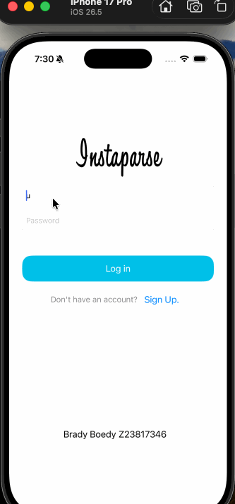

# lab3-bboedy2025
Mobile App Projects Codepath Lab3  
Brady Boedy  
Z23817346

## Instaparse - PT 2

### App Description
The Instaparse app is an app created to mimic basic featuers of instagram. Users can choose to either sign up or log into their account. Once created, they then have the option to post a photo from their camera roll with a caption of their choice, or use their camera to take a photo. If a new user logs in without posting anything, all existing posts in the feed will remain blurred until the new user posts as well. 

### App Walk-through

 

### Required Features
- [x] 1. Users are able to use the camera to take a photo and upload it to the server (your Parse server)  
- [x] 2. Users are not able to see other users’ photos until they upload their own.  
    - Fetch the 10 most recent photos within the last 24 hours from the server.
        - Of those returned in the response, only show the post if the createdAt property is within 24 hours of the logged in user’s last post. Else, just hide it.
            - Students have an option to implement a blur view in the project.
        - For storing when the user last made a post, create a lastPostedDate property in the User object that gets updated whenever the user uploads a photo
